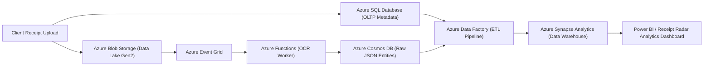

# Microsoft DP-900 (Azure Data Fundamentals) — Architectural Alignment Guide

This document articulates how **Receipt Radar** maps directly onto the core pillars of the **Microsoft Certified: Azure Data Fundamentals (DP-900)** exam curriculum. It serves as an academic defense and reference guide for college faculty and technical evaluators.

---

## 1. Mapping Core Data Workloads in Receipt Radar

In DP-900, cloud data is categorized into three distinct fundamental workloads. Receipt Radar leverages all three:

```
                               ┌───────────────────────────────────────────────────────────┐
                               │                    RECEIPT RADAR DATA                     │
                               └─────────────────────────────┬─────────────────────────────┘
                                                             │
                  ┌──────────────────────────────────────────┼──────────────────────────────────────────┐
                  │                                          │                                          │
                  ▼                                          ▼                                          ▼
       [STRUCTURED DATA]                          [SEMI-STRUCTURED DATA]                       [UNSTRUCTURED DATA]
• Relational Tables: Users, Budgets,       • OCR Extraction Payloads (JSON)            • Original Scanned Images (JPEG/PNG)
  Receipt Master, Tax Breakdowns           • Dynamic Nested Line Items                 • Digital PDF Invoices
• Strict Schema, Foreign Keys, 3NF         • Schema-less key-value tags & telemetry    • Binary blobs, varied dimensions
• Technology: Azure SQL Database           • Technology: Azure Cosmos DB               • Technology: Azure Blob Storage
```

### Detailed Breakdown:

| DP-900 Workload Type | Description in Receipt Radar | Target Azure Service | Storage Format & Protocol |
| :--- | :--- | :--- | :--- |
| **Structured Data** | User profiles, transactional expense entries, category allocations, budget thresholds, relational integrity. | **Azure SQL Database / Azure Database for PostgreSQL** | Tabular, ACID-compliant RDBMS tables with strict schema DDL. |
| **Semi-Structured Data** | Variable OCR outputs, merchant invoice JSON trees, multi-currency line items, variable tax fields (GST/VAT). | **Azure Cosmos DB (NoSQL API)** | JSON Documents, partitioned by `/userId`. |
| **Unstructured Data** | Raw receipt photographs taken via mobile/web camera, scanned receipts, warranty card PDFs. | **Azure Blob Storage** | Block Blobs with Hot/Cool/Archive access tiers. |

---

## 2. OLTP vs. OLAP Processing in Receipt Radar

DP-900 emphasizes understanding the differences between Online Transaction Processing (OLTP) and Online Analytical Processing (OLAP):

### 2.1 Online Transaction Processing (OLTP)
- **Role in Project:** Real-time ingestion of receipts, user authentication, updating monthly budget counters, and recording audit trails.
- **Characteristics:** High-frequency, low-latency queries, atomic transactions (ACID), normalized to Third Normal Form (3NF) to eliminate update anomalies.
- **Azure Implementation:** Azure SQL Database Hyperscale or Azure Database for PostgreSQL Flexible Server.

### 2.2 Online Analytical Processing (OLAP)
- **Role in Project:** Monthly category expense trends, year-over-year spending analytics, merchant frequency analysis, and budget burn rate projections.
- **Characteristics:** Read-heavy, complex aggregations (`SUM`, `AVG`, `GROUP BY`), multi-dimensional slice-and-dice data modeling.
- **Azure Implementation:** Star Schema in **Azure Synapse Analytics** or serverless SQL pools querying parquet files in **Azure Data Lake Storage Gen2**.

---

## 3. End-to-End Modern Data Analytics Pipeline on Azure



1. **Ingest:** Client uploads image to Azure Blob Storage; Event Grid triggers serverless Azure Function for OCR extraction.
2. **Store:** Structured metadata is stored in Azure SQL Database; raw unstructured image remains in Blob Storage; semi-structured OCR results land in Azure Cosmos DB.
3. **Transform:** Azure Data Factory orchestrates batch transformation pipelines during off-peak hours, aggregating expenses into star-schema dimension and fact tables.
4. **Analyze & Visualize:** Azure Synapse Analytics fuels executive reporting, while Recharts in the client application renders real-time expense radar charts.

---

## 4. Azure Storage Tiering & Cost Optimization

Receipt Radar implements smart data lifecycle management to optimize cloud costs:

| Tier | Availability & Latency | Retention Period | Cost Impact |
| :--- | :--- | :--- | :--- |
| **Hot Tier** | Millisecond access for active daily receipts and warranties under 90 days. | Days 0–90 | Highest storage cost, lowest access cost. |
| **Cool Tier** | Immediate access for past receipts accessed for quarterly tax audits. | Days 91–365 | Discounted storage cost (~50% cheaper than Hot). |
| **Archive Tier** | Offline deep storage for tax and audit compliance records (7-year retention). | Year 2–7 | 90% cheaper storage; rehydration latency 1–15 hours. |

---

## 5. Security & Governance Pillars (DP-900 Domain)

- **Authentication & RBAC:** Managed via Microsoft Entra ID (formerly Azure Active Directory) with Role-Based Access Control (RBAC).
- **Encryption at Rest:** Azure Storage Service Encryption (SSE) with 256-bit AES encryption; Azure Key Vault managing Customer-Managed Keys (CMK).
- **Encryption in Transit:** Enforced TLS 1.3 encryption across all public and internal endpoints.
- **Data Masking & Privacy:** Dynamic Data Masking (DDM) on payment card fields (`card_last_4`) and India DPDP Act compliant user data anonymization.
