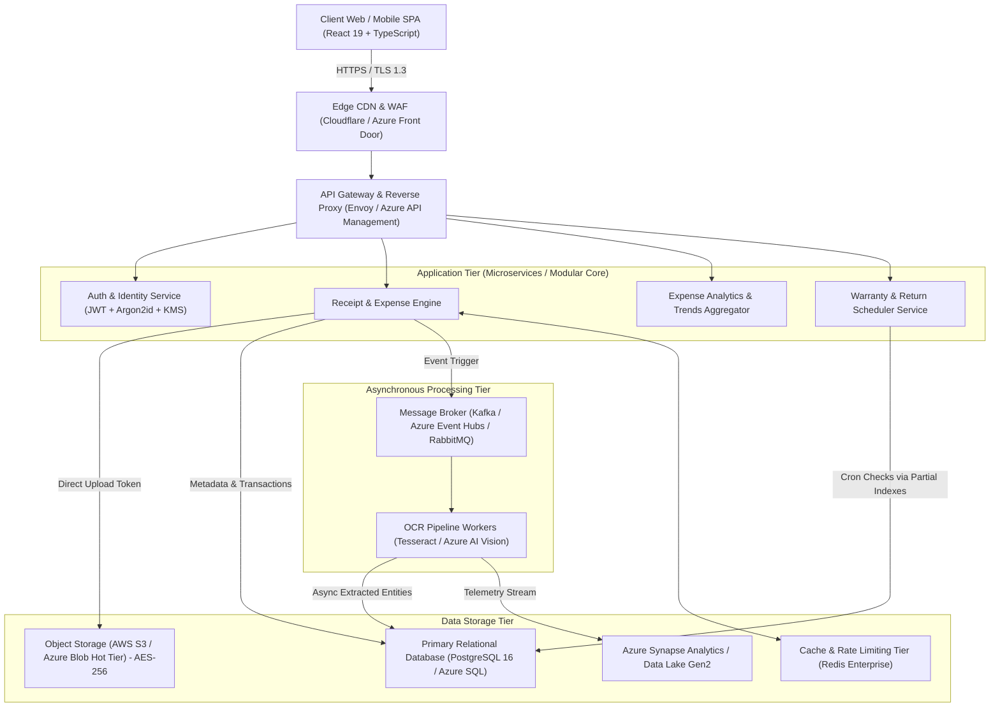
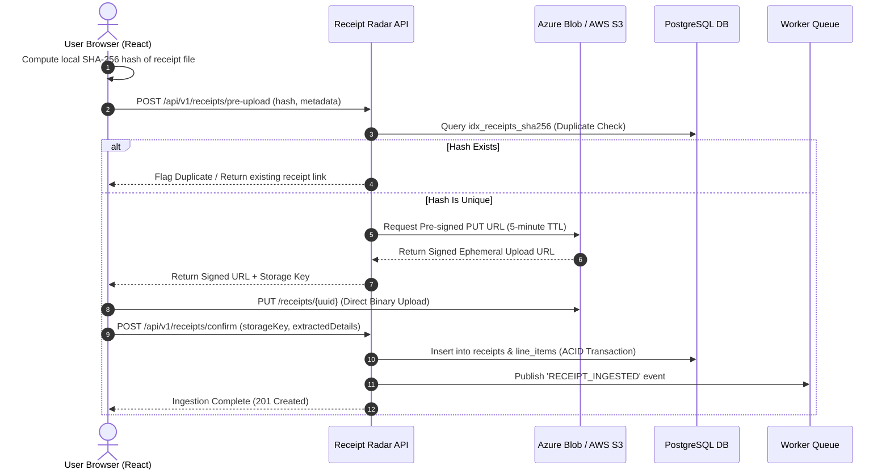

# Receipt Radar — System Design & Architecture Document

## 1. System Overview & Problem Statement
Receipt Radar is an enterprise-grade Smart Receipt Management and Expense Intelligence Platform. It solves the critical bottlenecks of traditional expense tracking:
1. **Manual Inefficiencies:** Eliminates manual data entry via client-side and cloud-native Optical Character Recognition (OCR).
2. **Fraud & Duplication:** Computes client-side SHA-256 cryptographic fingerprints and fuzzy invoice heuristics to prevent duplicate bill reimbursements.
3. **Consumer Protection:** Automates warranty and return deadline alerting, preventing missed claim windows.
4. **Data Isolation & Compliance:** Enforces strict Row Level Security (RLS) and zero-knowledge storage principles compliant with DPDP (India) and PCI-DSS data standards.

---

## 2. High-Level Architecture (HLD)

---

## 3. Low-Level Design (LLD) & Ingestion Flow

### 3.1 Direct Client Pre-Signed Object Storage Upload
Traditional architectures upload multi-megabyte image payloads directly to application servers, consuming thread pools, saturating network bandwidth, and creating single points of failure.

Receipt Radar utilizes the **Pre-Signed Ephemeral Upload Pattern**:
1. **Hash Generation:** The browser computes the client-side cryptographic `SHA-256` digest of the receipt image before any network transfer.
2. **Upload Authorization Request:** The client asks the API Gateway for an upload URL, passing `{ sha256, mimeType, fileSizeBytes }`.
3. **Duplicate Pre-Check:** The server checks the database index `idx_receipts_sha256`. If the digest already exists for the user, it flags a duplicate instantly before bytes are transferred.
4. **Pre-Signed URL Generation:** The server invokes Cloud Object Storage (AWS S3 or Azure Blob) to generate a signed upload URL with an exact **5-minute TTL (Time To Live)** and constrained Content-Type.
5. **Direct Binary Transfer:** The client pushes the image directly to Cloud Storage via HTTP `PUT`. Zero image payload touches application web servers.
6. **Confirmation & Enqueue:** Client confirms completion with invoice metadata; an asynchronous OCR job is scheduled.

---

## 4. Scalability & Resilience Mechanisms

| Layer | Strategy | Benefit |
| :--- | :--- | :--- |
| **Edge & API Gateway** | Token Bucket Rate Limiting (Redis) | Prevents DDoS attacks and brute-force authentication attempts. |
| **Application Layer** | Stateless JWT Microservices | Horizontal auto-scaling under traffic spikes without sticky sessions. |
| **Database Read/Write**| Primary-Replica Read Splitting | Read replicas handle analytical reports; primary handles ACID transactions. |
| **Object Storage** | Lifecycle Policies (Hot -> Cool -> Archive) | Receipts older than 180 days transition to cool storage, slashing storage costs by 70%. |
| **Query Indexing** | Partial Conditional B-Tree Indexes | Indexes `WHERE has_warranty = TRUE` drastically reduce memory footprint. |

---

## 5. Security & Threat Modeling (STRIDE)

- **Spoofing Identity:** Mitigated by Argon2id hashed passwords, per-user salts, short-lived JWTs (15 min), and HttpOnly refresh tokens.
- **Tampering with Data:** Client pre-computes SHA-256. Database stores hash. If raw blob content is modified, checksum validation triggers security alert.
- **Repudiation:** Append-only `audit_logs` table records every create/update/export operation with IP address and user-agent.
- **Information Disclosure:** Multi-tenant database Row Level Security (RLS) ensures zero data leakage across user tenants.
- **Denial of Service:** Image uploads bypass application memory through direct cloud pre-signed URLs.
- **Elevation of Privilege:** Strict Role-Based Access Control (`user`, `business_owner`, `auditor`, `admin`).
